<div align="center">

# 🏨 LuxuryStay: Hotel Management System

### A complete hotel operations platform with 4 staff portals and a guest booking website

Online booking, walk-in reservations, room status tracking, billing, housekeeping, maintenance, staff management and reports, all role-based.


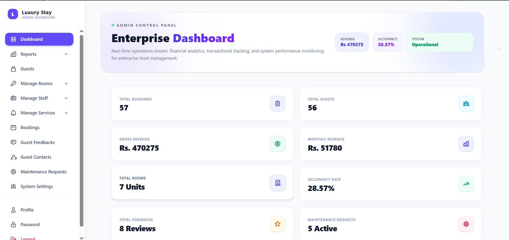

</div>

---

## ✨ What it does

LuxuryStay runs the whole hotel from one system: guests book online, the front desk handles walk-ins, housekeeping keeps rooms ready, and management sees everything in live dashboards and reports.

### 👥 Role-based portals

| Role | Key features |
|---|---|
| **🛡️ Admin** | Dashboard, reports, full CRUD for rooms, staff and services, bookings overview, guest feedback & contacts, maintenance resolution, system settings |
| **📊 Manager** | Dashboard, reports, staff & services overview, maintenance reporting, guest feedback & contacts |
| **🛎️ Receptionist** | Walk-in guest + booking in one flow, booking status management, room availability, billing & invoices, maintenance reporting |
| **🧹 Housekeeping** | Cleaning task board, "Mark Available" room workflow, maintenance reporting |
| **🧳 Guest** | Register/login, browse & book rooms, manage/cancel bookings, view & pay invoices, payment confirmation email, feedback |

### 🔄 Smart room & booking lifecycle

```
Booking: pending → confirmed → checked-in → checked-out
Room:    Available → Occupied → Cleaning → Available
```
- Online bookings start as **pending** until the receptionist confirms them; walk-ins are **confirmed** instantly
- Check-in marks the room **Occupied**, check-out sends it to **Cleaning**, and housekeeping returns it to **Available**
- After check-out the receptionist generates the bill
- Walk-in guests automatically receive a **set-your-password email**

## 📸 Screenshots

| Guest website | About & rooms |
|---|---|
| 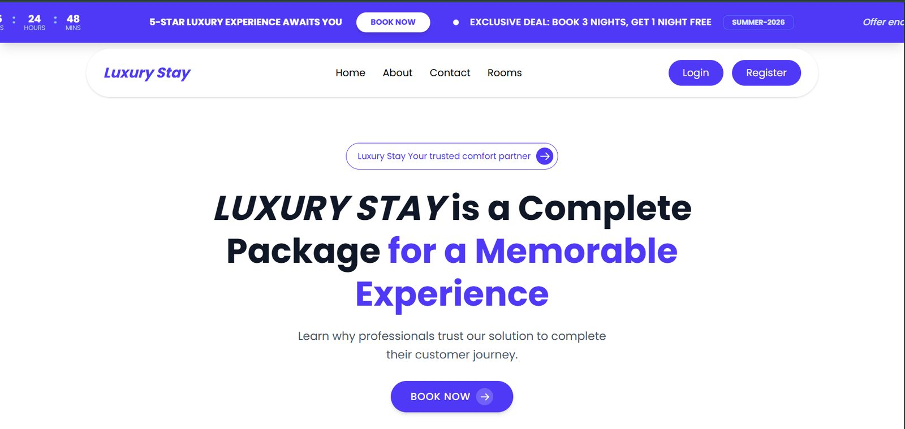 | 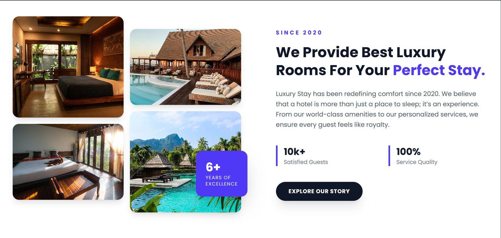 |

| Room inventory | Bookings registry |
|---|---|
| 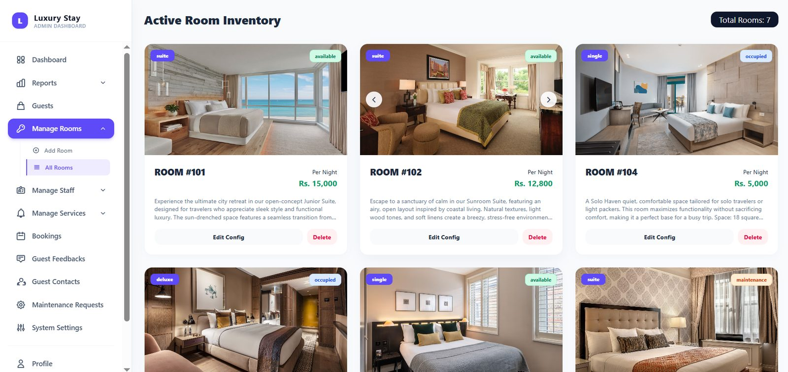 | 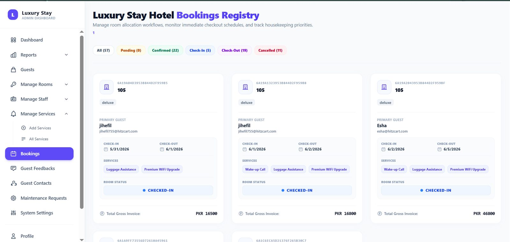 |

| Walk-in reservation | Billing & invoices |
|---|---|
| 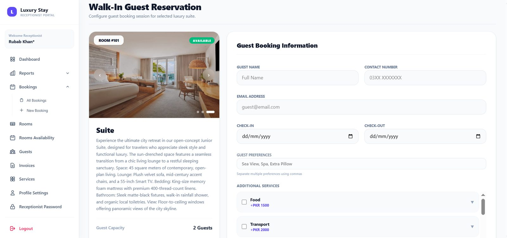 | 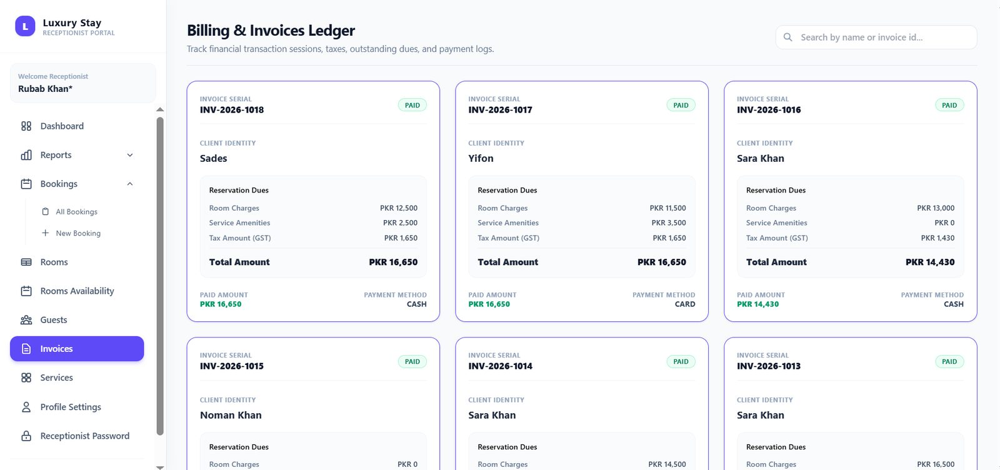 |

| Staff directory | Hotel services |
|---|---|
| 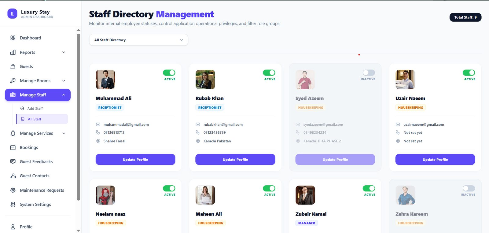 | 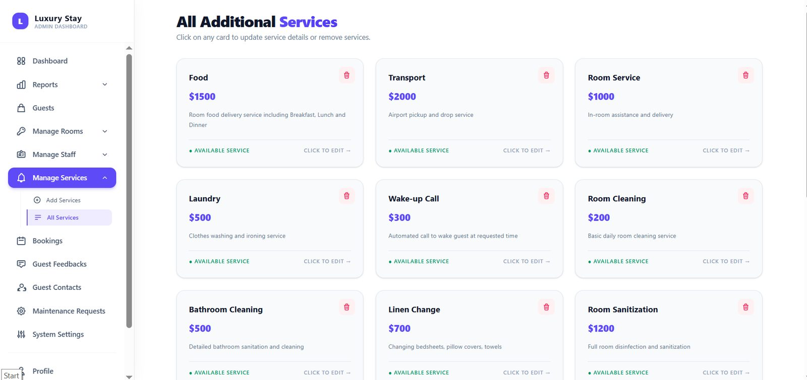 |

| Manager dashboard | Housekeeping dashboard |
|---|---|
| 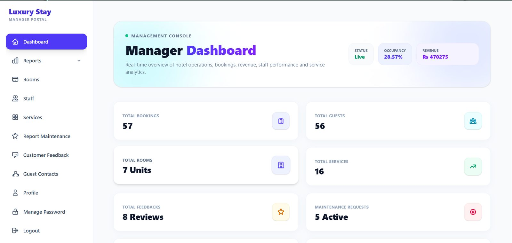 | 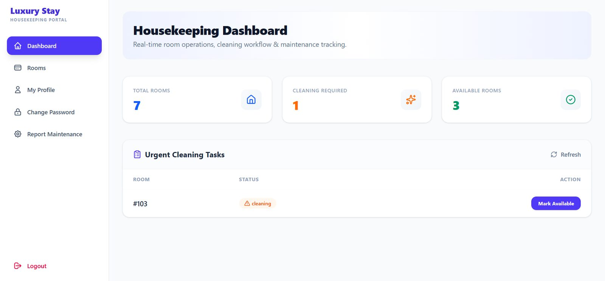 |

| Guest feedback |
|---|
| 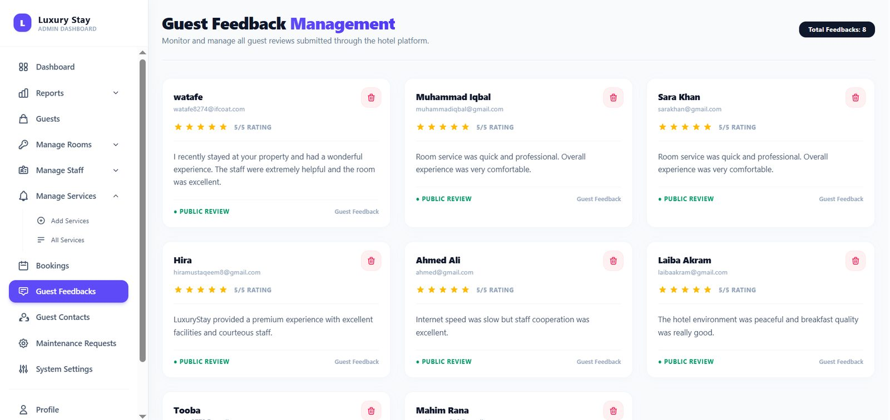 |

## 🛠️ Tech stack

- **Frontend:** React 19, Vite, Tailwind CSS, React Router 7, Axios, Lucide icons, React Toastify
- **Backend:** Node.js, Express, MongoDB, JWT authentication with role-based authorization, email notifications
- **Auth:** separate guest and staff (management) login flows, password reset and set-password links

## 🏗️ Project structure

```
src/
├── Admin/          # Admin portal: dashboard, rooms, staff, services, reports, settings
├── Manager/        # Manager portal and reports
├── Receptionist/   # Front desk: bookings, walk-ins, invoices, availability
├── Housekeeping/   # Cleaning tasks and room status
├── Registration/   # Login, register, booking, profile, password flows
├── Components/     # Guest website sections (hero, rooms, FAQ, reviews…)
├── Pages/          # Guest website pages
└── api/            # Axios instance with JWT interceptor
```

## 🚀 Run locally

```bash
git clone https://github.com/mahimrana219/luxurystay-hotel-management.git
cd luxurystay-hotel-management
cp .env.example .env    # set VITE_API_URL to your backend
npm install
npm run dev
```

> ℹ️ This repository contains the **frontend**. The backend API (Node.js, Express, MongoDB) is kept private.

---

<div align="center">

**Mahim Rana** · Full-Stack Developer

[Portfolio](https://mahimrana-portfolio.vercel.app/) · [LinkedIn](https://www.linkedin.com/in/mahimrana219/) · [GitHub](https://github.com/mahimrana219)

</div>
